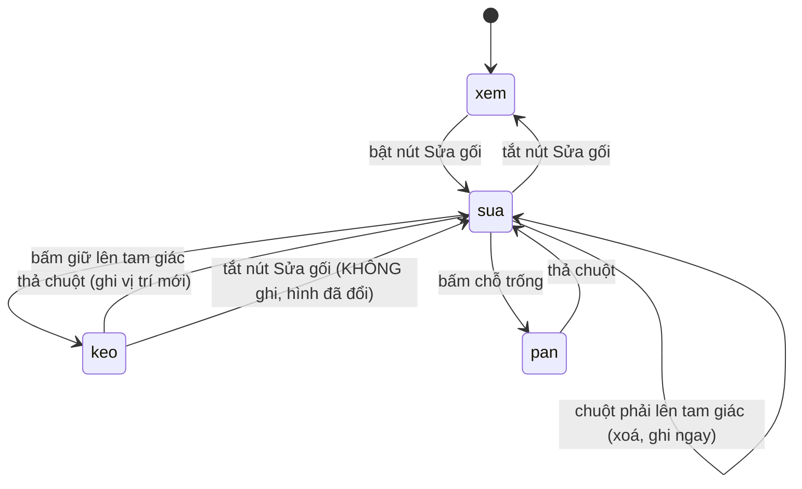

# Sửa gối

## Tóm tắt

Sửa gối cho người dùng quyết định mô hình khung ngang được đỡ ở đâu và đỡ kiểu gì. Gối chỉ đặt được trên **bản đáy**, tại đúng vị trí một node đã có; mỗi gối mang một **loại** (chốt, con lăn, ngàm) quyết định bậc tự do nào bị khoá khi ghi ra file MCT. Không đặt gối riêng thì lúc tạo MCT phần mềm dùng bộ mặc định.

Chế độ này bật bằng nút **Sửa gối** trên dải nút ngay trên khung xem, cạnh các thẻ chế độ xem. Nút là nút bật/tắt: khi bật, con trỏ trong khung xem đổi từ hình chữ thập sang hình bàn tay chỉ, danh sách gối trong dock *Properties* mở ra, và dưới danh sách hiện dòng nhắc *"Trên hình: bấm node đáy để đặt · kéo tam giác để dời · chuột phải để xóa"*. Chế độ này chỉ dùng được khi có mô hình đang nạp; project rỗng thì danh sách chỉ ghi *"Chưa nạp mô hình"*.

Gối lưu **theo toạ độ X**, không theo số hiệu node. Đổi cách chia phần tử hay sửa bản vẽ thì số hiệu node đổi hết, còn vị trí gối trên bản đáy thì không.

## Trường hợp đơn giản

Người dùng chọn một mặt cắt đã tạo MCT, bấm **Sửa gối**. Khung xem giữ nguyên hình, nhưng giờ mỗi node bản đáy trở thành một đích bấm được, và các ký hiệu gối đang có sáng lên màu nhấn.

Người dùng bấm vào một node bản đáy chưa có gối. Một gối **con lăn** xuất hiện ngay tại đó: tam giác rỗng kèm hai bánh lăn, vẽ phía dưới node. Danh sách bên dock thêm một hàng, tiêu đề đổi thành *GỐI (3)*.

Thấy đặt hơi lệch, người dùng bấm giữ lên chính tam giác đó và kéo ngang. Gối bám theo, nhảy từ node đáy này sang node đáy kia chứ không trượt tự do. Thả chuột là xong; vị trí mới được ghi vào project ngay.

Muốn đổi loại, người dùng bấm một trong ba nút icon trên hàng của gối đó trong dock. Muốn bỏ hẳn, bấm chuột phải lên tam giác. Cả hai đều có hiệu lực tức thì, không có bước xác nhận và **không hoàn tác lại được**.

## Diễn biến tương tác, theo từng sự kiện

### Mở

Tác vụ mở khi con trỏ đi xuống trong khung xem lúc chế độ Sửa gối đang bật. Ngay khoảnh khắc đó phần mềm quyết định **đích là gì**, theo đúng thứ tự này:

1. Con trỏ có đang chạm một **ký hiệu gối** không. Vùng chạm là một hộp quanh node: rộng 13 điểm ảnh mỗi bên, cao từ 4 điểm ảnh phía trên node xuống 24 điểm ảnh phía dưới — hộp lệch xuống vì tam giác vẽ *phía dưới* node. Chạm nhiều gối thì lấy gối có tâm gần con trỏ nhất theo phương ngang.
2. Không chạm gối nào thì tìm **node bản đáy** gần con trỏ nhất **trong bán kính 14 điểm ảnh**. Xa hơn thế thì không có node nào được coi là đích.
3. Không có mô hình thì không có gì xảy ra cả.

Nếu đích là một ký hiệu gối và nút bấm là **chuột phải**, gối bị xoá ngay tại đây và tác vụ kết thúc. Nếu là nút khác, gối đó được ghi nhận là **đang kéo** và tác vụ đi tiếp.

Nếu đích là một node bản đáy và nút bấm là **chuột trái**, phần mềm kiểm xem node đó đã có gối chưa. Chưa có thì đặt một gối mới, luôn luôn loại **con lăn**, rồi kết thúc. Đã có rồi thì **không có gì xảy ra và không có thông báo nào**.

Không có đích nào — con trỏ ở xa mọi node đáy quá 14 điểm ảnh — thì cú bấm trở thành **kéo màn hình**. Trong chế độ Sửa gối, kéo màn hình vì thế vẫn dùng được bình thường ở mọi chỗ trống.

> Ghi chú kỹ thuật: bán kính 14 điểm ảnh đo trên màn hình, không đo theo mét của mô hình. Thu nhỏ hình lại thì cùng bán kính ấy trùm lên nhiều node đáy hơn.

### Kết thúc ngay

Ba đường kết thúc mà chưa thành việc dài, và cả ba đều **ghi ngay xuống project**:

- **Đặt một gối mới.** Danh sách gối được sắp lại theo toạ độ X, rồi phát đi. Mặt cắt đang chọn nhận danh sách mới và project được đánh dấu là đã đổi.
- **Xoá một gối.** Như trên.
- **Bấm chuột trái lên node đáy đã có gối.** Không ghi gì. Đây là trường hợp *"không có gì xảy ra"* mà người kiểm thử có thể kiểm được.

Chế độ Sửa gối **vẫn bật** sau cả ba; người dùng ở nguyên đó để làm tiếp.

Bấm chuột phải vào chỗ *không* có gối không xoá gì; nó rơi xuống nhánh kéo màn hình.

### Thành việc dài

Lằn ranh là **bấm giữ trúng một ký hiệu gối rồi di chuột**. Không có ngưỡng khoảng cách: chỉ cần con trỏ nhích một điểm ảnh khi đang giữ chuột trên tam giác là gối đã bắt đầu dời.

Chốt lại từ khoảnh khắc bấm: **chỉ số của gối trong danh sách**. Loại gối không đổi trong suốt cú kéo.

Dấu hiệu nhìn thấy: ký hiệu gối đang kéo đổi sang màu nhấn để tách khỏi các gối còn lại.

### Đang chạy

Mỗi lần con trỏ dịch, phần mềm đổi toạ độ ngang của con trỏ về toạ độ mô hình, tìm node bản đáy gần nhất, rồi **dời gối tới đúng node đó**. Gối vì thế nhảy từ node sang node chứ không trượt liên tục — người dùng thấy nó bám lưới.

Một node chỉ nhận một gối: nếu node gần nhất đã bị gối khác chiếm, gối đang kéo **đứng im** cho tới khi con trỏ rời sang node khác. Không có thông báo nào giải thích vì sao nó không đi tiếp.

Trong lúc kéo, phần mềm **không** ghi gì xuống project và **không** cập nhật dòng truy vấn dưới khung xem. Rê chuột tra node cũng ngừng hoạt động cho tới khi thả.

### Kết thúc

Thả chuột. Danh sách gối được sắp lại theo toạ độ X rồi phát đi một lần; mặt cắt đang chọn nhận danh sách mới, project được đánh dấu đã đổi, con trỏ trở về hình bàn tay chỉ.

Cái được ghi xuống là **toạ độ X**, không phải số hiệu node. Lúc tạo MCT, mỗi toạ độ mới được quy về node đáy gần nhất *tại thời điểm ghi*.

Không có bước hoàn tác. Cách duy nhất quay lại là bấm **Mặc định** trong dock, và nút đó xoá **toàn bộ** gối tự đặt chứ không lùi một bước.

## Biến thể

| Biến thể | Đặt lúc mở | Đổi giữa chừng |
| --- | --- | --- |
| Shift | Không có tác dụng. | Không có tác dụng. |
| Ctrl | Không có tác dụng. | Không có tác dụng. |
| Alt / Space | Không có tác dụng. | Không có tác dụng. |
| Trạng thái mặt cắt | Không ảnh hưởng thao tác. Sửa gối được ở cả năm trạng thái, miễn là mô hình đã nạp. Sửa gối **không** đẩy mặt cắt về trạng thái sớm hơn, nên một mặt cắt `assigned` vẫn giữ nguyên bảng nội lực cũ dù sơ đồ gối đã khác. | Không có tác dụng. |
| Cổng giấy phép | Không kiểm. Sửa gối không đi qua cổng giấy phép; cổng chỉ chặn ở bước tạo MCT. | Không có tác dụng. |
| Tuỳ chọn liên quan | Bảng màu quyết định màu ký hiệu và màu gối đang kéo. Không có tuỳ chọn nào đổi được hành vi. | Đổi bảng màu giữa lúc kéo thì danh sách gối trong dock được dựng lại, nhưng cú kéo trên hình vẫn tiếp tục. |

**Không một phím bổ trợ nào có tác dụng trong tính năng này.** Đây là điều đáng chú ý chứ không phải chuyện tất nhiên: kỹ sư quen CAD sẽ thử Shift để giữ theo phương ngang, Ctrl để chép một gối, Esc để bỏ cú kéo — cả ba đều không có. Xem [B-02](../bug-triage.md#b-02).

## Huỷ và ngắt

| Sự kiện | Trước khi thành việc dài | Khi đang kéo |
| --- | --- | --- |
| Esc | Xoá lựa chọn node đang sáng. Không rời chế độ Sửa gối. | **Không có tác dụng.** Cú kéo không huỷ được; muốn thôi thì phải thả chuột và chấp nhận vị trí đó. |
| Đổi mặt cắt · đổi thẻ xem · tắt nút Sửa gối | Chế độ tắt, danh sách gối của mặt cắt mới được nạp. | Tắt nút Sửa gối **bỏ cú kéo mà không ghi**, trong khi toạ độ gối trên hình đã bị đổi rồi. Hình và project nói hai chuyện khác nhau cho tới lần nạp lại sau. Xem [B-01](../bug-triage.md#b-01). |
| Đóng cửa sổ hoặc thoát app | Thay đổi đã ghi vào project trong bộ nhớ; app hỏi lưu theo lệ thường. | Cú kéo mất, vị trí mới không được ghi. |
| Môi trường hỏng (Midas, ổ đĩa, quyền ghi) | Không liên quan: thao tác này không chạm đĩa và không chạm Midas. | Không liên quan. |
| Mặt cắt bị xoá khỏi project | Khung xem bị xoá mô hình, danh sách gối về *"Chưa nạp mô hình"*. | Chưa kiểm chứng được bằng tay; xem *Câu còn để ngỏ*. |
| File kết quả bị chiếm | Không liên quan. | Không liên quan. |
| Cổng giấy phép đổi trạng thái | Không liên quan: thao tác này không qua cổng. | Không liên quan. |
| Kéo thả file mới vào cửa sổ | Mặt cắt mới được thêm và **được chọn ngay**, nên mô hình trong khung xem đổi và chế độ Sửa gối áp lên mặt cắt mới. | Chưa kiểm chứng được bằng tay. |

Sau mọi ngắt quãng, chế độ Sửa gối hoặc còn bật (nếu chỉ là Esc) hoặc tắt hẳn (nếu đổi mặt cắt). Không có khái niệm *bản nháp gối* được giữ lại: mọi thay đổi hoặc đã ghi ngay khi xảy ra, hoặc mất hẳn.

## Tương tác với phần khác

**Cổng giấy phép.** Không đi qua cổng. Người dùng hết hạn dùng thử vẫn sửa được gối; họ chỉ không tạo được MCT.

**Project và trạng thái mặt cắt.** Gối thuộc về *một* mặt cắt, lưu trong `.mtbproj`. Sửa gối **không** đổi trạng thái mặt cắt, nên một mặt cắt đã `assigned` vẫn hiện là đã có kết quả dù sơ đồ gối vừa đổi và file MCT cũ không còn khớp. Xem [B-03](../bug-triage.md#b-03).

**Số liệu template.** Không liên quan.

**Nhật ký Messages.** Sửa gối **không ghi gì vào nhật ký**. Đặt, dời, xoá gối đều im lặng hoàn toàn ở dock Messages.

**Thanh bước và thanh trạng thái.** Không đổi. Sửa gối không phải một bước trong năm bước quy trình.

**Bảng màu và tuỳ chọn.** Ký hiệu gối và màu gối đang kéo lấy từ bộ token của bảng màu đang dùng. Danh sách gối trong dock được dựng lại mỗi lần đổi bảng màu.

**File trên đĩa.** Không ghi gì cho tới khi người dùng lưu project hoặc tạo lại MCT. Danh sách gối chỉ đi vào file MCT ở lần tạo tiếp theo.

**Midas bên ngoài.** Không liên quan.

## Trường hợp biên

- **Bán kính chạm đo bằng điểm ảnh, không đo bằng mét.** Thu nhỏ hình thì 14 điểm ảnh trùm lên nhiều node đáy, và node nào trúng phụ thuộc mức phóng chứ không phụ thuộc bản vẽ. Phóng to thì phải bấm chính xác hơn.
- **Gối luôn sinh ra là con lăn.** Không có cách nào đặt thẳng một gối chốt hay ngàm; phải đặt rồi đổi loại trong dock.
- **Node đã có gối thì bấm vào không phản hồi gì.** Không có nháy, không có dòng nhắc, không có tiếng.
- **Kéo gối vào node đã bị chiếm thì nó đứng im**, trông như phần mềm bị treo trong khoảnh khắc đó.
- **Hai gối rất gần nhau** thì vùng chạm 26 điểm ảnh chồng lên nhau; phần mềm lấy gối có tâm gần con trỏ nhất theo phương ngang, nên gối bị che vẫn chọn được nếu con trỏ lệch về phía nó.
- **Mặt cắt hai hộp** có ba dãy node đáy; không có gì ngăn người dùng đặt cả ba gối lên cùng một hộp và để hộp kia không đỡ. Phần mềm không kiểm tính hợp lý của sơ đồ gối.
- **Xoá hết gối** đưa mặt cắt về đúng trạng thái *"chưa đặt gối riêng"*, và lúc tạo MCT sẽ dùng lại bộ mặc định. Danh sách hiện lại dòng nhắc tương ứng.
- **Bấm hai lần thật nhanh lên một node trống** đặt gối ở lần bấm thứ nhất; lần thứ hai rơi vào nhánh *"node đã có gối"* và không làm gì.

## Câu còn để ngỏ và việc kiểm chứng

- **Đã kiểm chứng trên widget thật** (dựng `FrameView`, nạp `output/S1/S1_topo.json`, phát sự kiện chuột thật): việc tắt chế độ giữa lúc kéo làm hình và project lệch nhau ([B-01](../bug-triage.md#b-01)); việc bấm vào node đã có gối im lặng hoàn toàn ([B-06](../bug-triage.md#b-06)); bán kính chạm 14 điểm ảnh.
- **Đã kiểm chứng bằng cách đọc mã, chưa bấm tay:** phần còn lại của mục *Diễn biến tương tác*. Cần một lượt kiểm tay để xác nhận cảm giác của cú kéo và việc gối đứng im khi gặp node đã chiếm.
- **Một khẳng định đã bị chính phép kiểm bác bỏ:** bản đầu của tài liệu này viết rằng bấm xa bản đáy vẫn đặt được gối, vì đọc sót dòng khởi tạo bán kính. Chạy thử thì không tái hiện được. Đã sửa.
- **Chưa kiểm chứng được:** chuyện gì xảy ra khi mặt cắt đang sửa bị xoá khỏi project *giữa lúc đang kéo*, và khi kéo thả một DXF mới vào cửa sổ giữa lúc đang kéo. Cả hai đòi hai nguồn sự kiện cùng lúc, khó dựng bằng tay.
- **Đáng coi là lỗi hơn là đáng ghi thành tài liệu:** tắt nút Sửa gối giữa lúc kéo làm hình và project lệch nhau ([B-01](../bug-triage.md#b-01)); không có cách nào huỷ một cú kéo ([B-02](../bug-triage.md#b-02)); sửa gối không đánh dấu kết quả cũ là đã lạc hậu ([B-03](../bug-triage.md#b-03)).
- **Giả thiết tài liệu này dựa vào:** người dùng chỉ có một cửa sổ app mở tại một thời điểm. App không ngăn mở hai cửa sổ, và hai cửa sổ cùng mở một `.mtbproj` thì chưa ai thử.

Đối chiếu với commit `ab1e907`.
